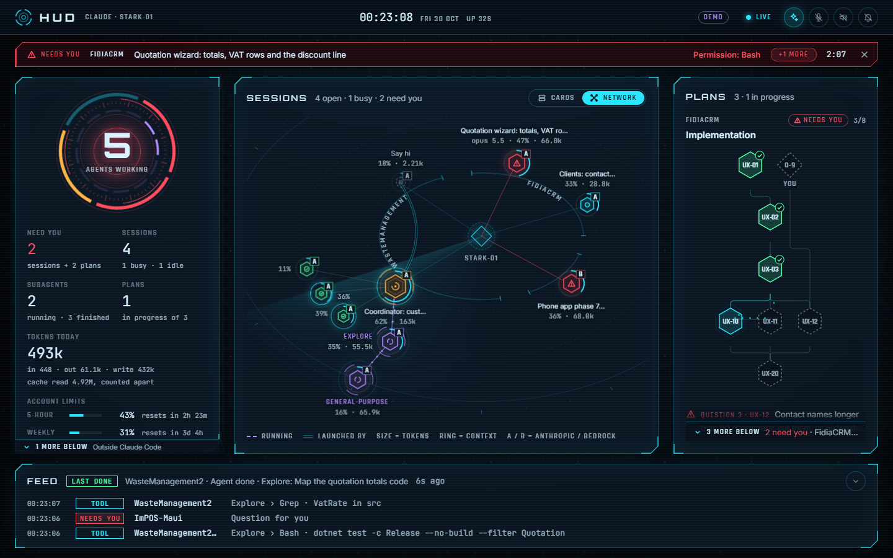

# Claude HUD

One local web page, `http://127.0.0.1:7777`, that shows every Claude Code session running on this PC, live, in
every project:
- what each session is doing, and which subagents it has started (and which subagent started which);
- tokens per session and per subagent, and how full each one's context window is;
- which sessions need you (a permission prompt, a question, waiting for input);
- the boards of the plans in those projects;
- your account's 5-hour and weekly usage, as Claude Code itself last cached it.

It's one file, `hud.mjs`, using Node 22 built-ins only: there's no `npm install` and no build step. It makes no model
or API calls, so it costs no Claude usage. It listens on 127.0.0.1 only, unless you start it with `--lan` (see
[Viewing it from another device](#viewing-it-from-another-device)).



*The network view, with `node hud.mjs --demo`: who started whom, sized by tokens, ringed by context fill. Two
sessions need you (red).*

## Commands

```
node hud.mjs                     serve on http://127.0.0.1:7777 (HUD_PORT picks another port)
node hud.mjs --lan               also open it to other devices on the network, view only (or set HUD_LAN=1)
node hud.mjs --demo              serve simulated sessions, subagents, plans and events
node hud.mjs --demo=dense        the same with 24 sessions
node hud.mjs install             add the HUD's hooks to every watched folder's settings.json (backup first; safe to repeat)
node hud.mjs uninstall           remove only the HUD's hooks from those files
node hud.mjs autostart on|off    start the HUD at logon (Task Scheduler, no window), or stop doing so
                                 (`autostart on --lan` starts it open to the network)
node hud.mjs lint [repo] [--json]  check a repository against the agent workflow standard (workflow/STANDARD.md)
node hud.mjs selftest            check the model normaliser, redaction and plan parser
```

Routes: `/` (the page), `/design` (the component gallery), `/api/state` (the full state as JSON), `/api/stream`
(server-sent events), `/api/health`, and `POST /event`, which the hooks use. Requests whose `Host` header is not
`127.0.0.1:<port>` or `localhost:<port>` are refused (with `--lan`, an IP address or this PC's name is accepted too).

## Viewing it from another device

Start the HUD with `node hud.mjs --lan` (or `HUD_LAN=1`; `node hud.mjs autostart on --lan` makes the logon task do
it). It then listens on all network interfaces and prints the addresses to open, for example
`http://192.168.68.73:7777` in a phone, tablet or TV browser on the same network.

- **View only.** `POST /event` and `/usage` are accepted from this PC alone, so another device can look but cannot
  report sessions to the HUD. The hooks keep working, because they run on this PC.
- **No password.** Anyone on the network who can reach the port sees the page: project names, folder paths, session
  titles and redacted tool summaries. Use it on a network you trust, and leave `--lan` off otherwise.
- **Firewall.** Windows must allow inbound TCP on the port (7777, or `HUD_PORT`) for your network profile. If the
  address does not load from the other device, check that first.
- **Wrong name.** Opening it by a domain name, or by an IP address with a different port, answers 403.
- **Fonts.** The page loads its fonts from Google Fonts; a device without internet falls back to system fonts.

## Setting it up

1. `node hud.mjs` (or `node hud.mjs autostart on` to have it start at every logon).

That's all: each time it starts, the HUD installs its hooks into every Claude Code folder it watches (`~/.claude` and
any `~/.claude-*`), so there's nothing else to run. Open sessions pick the hooks up by themselves. Set
`HUD_NO_AUTOINSTALL=1` to make it leave `settings.json` alone; `node hud.mjs install` does the same by hand.

Without the hooks the HUD still works: it reads the session list and the transcripts, so you see sessions, titles,
models, tokens and subagents. The hooks add the live parts: the tool running right now, "needs you", and
instant updates.

## Using the page

Open `http://127.0.0.1:7777`. The page answers three questions, in this order:
1. **Does anything need me?** A red banner under the top bar, a red reactor, red nodes and rows. Click the banner
   to go to the session; × hides it until that session asks again.
2. **What is running?** The number in the reactor, amber sessions, violet subagents.
3. **What just finished?** LAST DONE in the feed header, and green checks.

**Sessions** show as a **network** or as **cards** (the switch above them; the page remembers your choice, and
`?view=network` or `?view=cards` in the address picks one).
- **Network:** each session hangs off the hub (this PC), and each subagent off whoever started it.
  - Node size is tokens, and the ring around a node is how full its context is. `A` / `B` marks Anthropic or
    Bedrock.
  - A double line means "launched from that session's shell". A dashed `+n` node holds finished subagents (click to
    show them).
  - Hover a node for its details, or click to pin its card. With the keyboard: arrow keys move between nodes, Enter
    pins, Escape unpins.
- **Cards:** one card per session, with its current tool, tokens, context and subagents. Above 8 open sessions they
  turn into one-line rows. When a panel has more than fits, a bar at its bottom says what is out of sight; click it
  to scroll there.

**Plans** shows the boards of the projects with open sessions: each phase as a hexagon, colour and badge for its
state, and the questions waiting for you. **Feed** is the live event list: hover to pause it; the chevron
collapses it.

**Top bar toggles**, all remembered in the browser:
- **Effects:** the ambient motion (rotating reactor, radar, floating nodes). Off, everything that moves still means
  something. Your system's reduced-motion setting turns it off too.
- **Voice** and **sound:** short spoken or tonal announcements ("FidiaCRM needs your approval"). Off by default.
- **Notifications:** Windows notifications when a session needs you or a plan phase is blocked, bounced or handed
  off. Sent only while the tab is in the background.

`/design` is the component gallery: every part of the page in every state.

## What it reads, and what it never touches

| Source | What the HUD takes from it |
|---|---|
| `~/.claude/sessions/<pid>.json` | The list of running sessions: id, folder, name, busy or idle. The `*.key` files next to them are never opened. |
| `~/.claude/projects/<project>/<session>.jsonl` and `<session>/subagents/` | Title, model, effort, branch, tokens, tool names, provider, and subagents (their `meta.json` gives the parent). Of the `api-request` lines, only the model id. Read from where it left off, a line at a time. |
| Hook events (`POST /event`) | What the hooks send: event name, tool name and the few input fields a short summary needs. |
| `docs/**/STATUS.md`, `docs/plans/*.md` and `docs/status.md` in each project with a session | Plan boards, the plan's state, unticked decisions and open questions, and the project's one-line headline. |
| `~/.claude/settings.json` (and each other watched folder's) | Only `env.CLAUDE_CODE_USE_BEDROCK` (to label sessions as Bedrock) and whether the HUD's hooks are installed. The HUD writes to it only to add its own hooks, at start (backup first). |
| `~/.claude.json` | Only `cachedUsageUtilization`: the 5-hour and weekly usage Claude Code caches itself. |

It never reads `~/.claude/.credentials.json`, the session `*.key` files, `~/.aws/` or any `AWS_*` environment
variable. If `CLAUDE_CONFIG_DIR` is set, the HUD looks there instead of `~/.claude`, as Claude Code does.

**Text shown is short and redacted.** Titles, models, tool names, and a summary of each tool call (a file path, the
first 80 characters of a command) are shown. Full prompts, tool output and file contents never are. Before anything
leaves the process, passwords (`-P …`, `Password=…`), tokens, API keys, AWS keys and anything that looks like a
key are replaced with `•••`.

## The hooks

`install` (and the HUD at start) adds one entry for each of these events: SessionStart, SessionEnd, UserPromptSubmit, PreToolUse,
PostToolUse, PostToolUseFailure, Notification, Stop, SubagentStart, SubagentStop and PreCompact. Each runs
`node "<path>/hud.mjs" hook`. That command reads the event, posts it to the HUD, and:
- **prints nothing**, so nothing is added to Claude's context;
- **always exits 0**, so it can never block a tool or show an error;
- gives up after 400 ms, so a HUD that isn't running costs about 70 ms a call;
- runs `async` (except SessionEnd), so Claude Code doesn't wait for it.

It writes a backup (`settings.json.hud-backup-<date>`) first and leaves every other setting and hook as it was. When
the hooks are already there it changes nothing, so no backup piles up. It also repairs them if `hud.mjs` moved. A
`settings.json` that isn't valid JSON is left alone, with a message. `uninstall` removes only the HUD's entries from
every watched folder; when the result matches a backup, it restores that backup's exact bytes. Because the HUD adds
the hooks at every start, set `HUD_NO_AUTOINSTALL=1` (and `autostart off`) if you want them to stay removed.

## Bedrock

Sessions and subagents carry a provider (`anthropic`, `bedrock` or `unknown`), detected per agent from its
transcript, so it works however Claude Code was switched to Bedrock (shell, VS Code or system environment, or
`settings.json`):
- the model id of each request (`api-request` lines: `us.anthropic.claude-…`, `anthropic.claude-…-v1:0`,
  inference-profile ARNs). On Bedrock the reply's `message.model` is the plain name, so it can't tell on its own;
- Bedrock message ids (`msg_bdrk_…`), for transcripts without request lines;
- as a last resort, `CLAUDE_CODE_USE_BEDROCK` in the `env` block of `~/.claude/settings.json`.

Model ids are shown normalised (`claude-opus-5-5`); the raw id as sent stays in the state as `modelRaw`.

Bedrock usage from your own apps (outside Claude Code) can be added. Both ways are **off by default**:
- **Ingest:** start the HUD with `HUD_ACCEPT_USAGE=1`, and after each Bedrock response post the usage:

  ```js
  // After a Bedrock InvokeModel / Converse response `res` (fails silently when the HUD isn't running)
  fetch('http://127.0.0.1:7777/usage', {
    method: 'POST',
    headers: { 'content-type': 'application/json' },
    body: JSON.stringify({
      app: 'invoice-ocr', provider: 'bedrock', model: modelId,
      input: res.usage.inputTokens, output: res.usage.outputTokens,
      cacheRead: res.usage.cacheReadInputTokens ?? 0, cacheWrite: res.usage.cacheWriteInputTokens ?? 0,
    }),
  }).catch(() => {});
  ```
- **CloudWatch:** start the HUD with `HUD_BEDROCK_REGION=<region>`. Once a minute it runs `aws cloudwatch
  get-metric-data` with your own AWS CLI profile and shows today's token counts per model, a few minutes late and not
  split by app. CloudWatch API calls can carry a very small AWS charge: the only thing here that can cost money.

## Removing it completely

1. Stop the HUD if it's running, and `node hud.mjs autostart off` (removes the Task Scheduler task, if you turned it on),
   so nothing puts the hooks back.
2. `node hud.mjs uninstall` (removes the hooks from every watched folder's `settings.json`).
3. Delete this folder.
4. Optionally delete the backups the HUD left next to each `settings.json`: `settings.json.hud-backup-*`.

The HUD keeps everything else in memory only, so nothing else is left behind.
