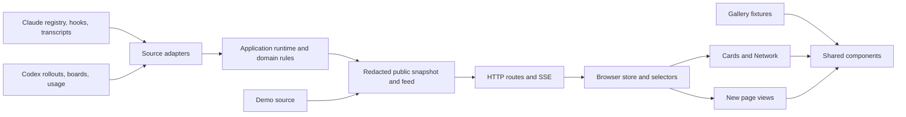

# Claude HUD architecture and refactor plan

Status: **proposed** · Written 2026-11-26 · Checked against the code 2026-11-26 · [Implementation board](STATUS.md)

## 1. Goal

A developer can build a new full-page HUD view by adding a browser module, registering it, and using the same live session, board, alert, and feed data that powers the current dashboard. They can also reuse pieces of the existing UI and test the view against fixtures. The first working example arrives at P4, while the existing server engine is still in place.

Split the server in the same direction. Runtime modules own collection and state, a single projection produces the public snapshot, and HTTP and browser code consume that snapshot. Keep Node 22, native ES modules, the existing commands, and a single local server. The migration proceeds in small, runnable steps so the dashboard stays usable as the code moves.

## 2. What exists

| Area | Finding | Consequence |
|---|---|---|
| Entry and deployment | The patched [`hud.mjs`](../../../hud.mjs) is 7,317 lines. It owns configuration, ingestion, state, HTTP, browser code, demos, Windows setup, lint, and self-test. [`hud-hook.mjs`](../../../hud-hook.mjs) already has a separate fast path. | Keep both root command paths. Move implementation behind them and load only what each command needs. Distribute the checkout or an archive containing the module and asset tree. |
| Collection | `scanRegistry`, `onHook`, `readTail`, `processLine`, `processCodexLine`, `scanCodex`, and subagent handling share maps and call each other directly. `serve()` starts watchers, polls, hook installation, the web server, and keepalives. | Extract sources with explicit connections to the runtime. Preserve incremental reading, hook and transcript ordering, session reconciliation, and watcher fallback. |
| Projects and boards | `rootFor` and `setCwd` discover projects and worktrees. `scanRoot` and `parsePlan` read boards. `followBoards` links agents, calculates board queues and marks, and attaches `work` to the public session and subagent values. | Separate file discovery and parsing from the board rules. Make those rules reusable by live and simulated data. |
| Public reads | `snapshot()` formats sessions, builds the Codex tree, calculates totals, checks alerts, and can push a feed event through `announceMarks`. HTTP health, state, and SSE can each invoke it. | Put alert and board transitions in the application update path. Serve one coherent, redacted snapshot without changing state merely because a client reads it. |
| Browser data | `pageMain()` owns EventSource, reconnection, missing-field merges, and the away-summary fetch. `createHud()` also fills missing fields, and `ticker()` separately maintains feed history. | Give each page one store for complete snapshots, connection state, and recent feed. Reuse it across views and retain the ticker's visual behavior. |
| Browser views | `hudPage()` serializes `hudClient`, `pageMain`, and `designMain` into inline scripts and embeds `HUD_CSS`. `createHud()` owns the DOM shell, hard-coded Cards/Network selection, focus, and panel rendering. `designMain()` reuses components with separate specimens. | Serve native browser modules and CSS as assets. Give each view an explicit mount and cleanup lifecycle and keep the gallery on shared components. |
| Test and release baseline | [Integration tests](../../../tests/) exercise the real CLI against temporary profiles. [Browser smoke](../../../tests/browser-smoke.mjs) uses isolated demo data. The live checkout also contains the Windows `procStart` fix in `hud.mjs` and its regression test. The [0.3 verification board](../hud-0-3/STATUS.md) still records a failed live memory gate. | Start from the exact patched checkout, preserve those checks, and measure before moving code. Treat resource performance as its own verification gate. |

## 3. Decisions

| ID | Topic | Proposal and rationale |
|---|---|---|
| D1 | Runtime and tools | Use Node 22 built-ins and native ESM on both sides. Add JSDoc for boundary types and fixtures for their behavior. The existing app runs directly on Node, and native browser modules provide the import boundaries needed here. |
| D2 | Public data | Preserve the existing JSON and SSE formats through the refactor. Define the public snapshot in one place. Future additive fields can go through that contract when a view has a documented need. |
| D3 | View design | Use one declarative view registry with two outlets. Cards and Network fill the session panel. A full-page layout can fill the page outlet and use the same browser store and services. |
| D4 | ★ Example view | Build an Activity preview at `/?view=activity` in demo mode. It shows sessions, project filtering, attention state, linked work, and the recent feed. This proves a distinct layout can run from the reusable interface. |
| D5 | ★ Deployment | Ship the full checkout or an archive with the entry scripts, modules, and assets together. Preserve the executable paths used by Task Scheduler and by Claude Code. Update the setup instructions as soon as external assets are required. |
| D6 | Delivery and performance | Keep the existing PID fix in the baseline and leave the 0.3 work independently releasable. Compare resource use on the same workload, and carry forward the existing live and stream budgets. Measure the effect of the refactor separately from any subsequent performance tuning. |

## 4. Architecture and contracts



### Module ownership

| Path | Responsibility and permitted dependencies |
|---|---|
| `hud.mjs`, `hud-hook.mjs` | Root CLI dispatcher and standalone hook. The CLI dynamically loads the requested command. The hook imports only Node built-ins and stays safe to import from the server or installer. |
| `src/cli/`, `src/config.mjs` | Command handlers, settings discovery, environment parsing, and installation. Pass explicit configuration to the runtime and Windows integration. Resolve distribution resources from the module location and keep `lint [repo]` relative to the invoker as it is today. |
| `src/app/` | Composition and process lifecycle. Own the running engine, refresh cycle, and subscriptions. Create fresh instances for demo, live, and tests. The runtime can close its timers, watchers, and other handles. |
| `src/sources/`, `src/platform/` | Files, hooks, account cache, and other external inputs. Windows process identity and Task Scheduler live here. Sources own reader offsets, retry/coalescing, and source-specific formats. They pass selected data to the application through narrow callbacks. |
| `src/domain/`, `src/contract/` | Session and subagent lifecycle, provider/model rules, usage math, plans, links, warnings, feed, and public shape definitions. Rules accept data, configuration, and explicit time. Domain code has no browser, HTTP, or filesystem imports. |
| `src/http/` | Node HTTP handling, public assets, header checks, bounded JSON input, and SSE. It calls the application interface and serves redacted plain data. |
| `src/web/` | Public-only browser assets. Entry points compose pages; `data/` owns the live transport, store, and selectors; `views/` owns layouts; `components/` owns reusable UI; `styles/` holds extracted CSS. Browser code imports from the browser tree and consumes the wire contract through data. |
| `src/demo/` | Synthetic session, board, alert, and feed scenarios using the same public contract. The component gallery uses deterministic browser fixtures through the same render interfaces. |

The application is the composition root. Each adapter gets only the callbacks and lookup capability it uses. Each domain module owns its maps, counters, or transition state. A second global bag passed around as `ctx` would preserve the coupling that caused this refactor.

### Public data and publication

- Define a JSON-serializable `HudSnapshot` with the current top-level fields `now`, `uptime`, `demo`, `version`, `host`, `hooksInstalled`, `sessions`, `projects`, `plans`, `board`, `alerts`, `feed`, `account`, `totals`, `external`, `externalError`, `push`, and the existing live `codex` metadata. Baseline fixtures capture nullable fields and live/demo differences. Keep epoch milliseconds, current enum values, ordering, and shape as observed in the baseline.
- Identify sessions by `session.id`, subagents by session plus agent ID, plans by the existing project/slug key, and work links by plan plus item ID. `board` carries resolved links, queues and marks. Views read that result and use selectors for display filtering, grouping, sorting, and joins. Keep server rules such as liveness, alert thresholds, and board precedence in the domain.
- Providers report bounded, selected facts through focused application inputs for registries, transcript updates, hooks, boards, and usage. Keep the distinct Claude and Codex status semantics. Project the internal state to DTOs once per update batch or timer-driven transition. Advance alert latches and board timers there, append feed records once, then publish the resulting state. Reads use the latest complete projection with request-time clock fields where applicable.
- Use a small in-process data source interface for live and demo. `readSnapshot()` returns the latest public snapshot, `subscribeUpdates(listener)` exposes state invalidations and feed lines and returns an unsubscribe function, and `close()` tears down the source. Keep writes on a distinct application interface for hook ingestion and optional usage reporting. Define and test the initial read and subscription ordering so a client cannot miss a transition or get it twice during setup.
- Preserve `GET /api/state` as the full snapshot, the first `state` event as a full replacement with `full: true`, later `state` events without `plans` and `feed`, `plans` as a whole-array replacement, and `event` as a feed line. Retain keepalives, retry timing, and change-gated batching. Preserve empty arrays and absent fields as distinct cases. Verify reconnect, plan/feed interleaving, multiple subscribers, and a server restart before removing the existing publication path.
- Publish through one redaction boundary for full snapshots, partial pushes, and feed events. Preserve early collection minimization and hook recording behavior. Keep LAN viewer access, host and origin checks, loopback-only ingress, size limits, and DOM text handling. Serve static files from a dedicated public asset tree with expected MIME types and validated path containment, including Windows path forms. Keep Claude/Codex data, server source, and local config outside that tree.

### Browser store and view interface

Use one store and one connection per mounted HUD page. `createHudStore({ transport, clock })` exposes `getSnapshot()`, `getConnection()`, and `subscribe(listener)`. It accepts a transport with initial and later SSE frames, a full-state fetch for the existing away flow, and a reconnect/close lifecycle. A fixture transport uses the same interface. The store publishes complete snapshots and supplies the existing feed delivery signal for ticker animations.

A full SSE frame re-seeds state on every new connection. A plan frame updates the current plan array without disturbing sessions or feed. A feed frame updates bounded recent history using the existing composite identity derived from time, session, project, kind, and text. Reconcile full frames with feed already delivered where necessary to retain the current ticker behavior across reconnects. Ignore invalid frames and stale callbacks from a replaced connection. Track server/browser clock offset separately from the connection status. Move the away-summary fetch policy into a browser service that reads through the transport. Keep hover pause, animation, audio, focus, and display preferences in the UI.

A view descriptor has a key, an outlet, and a mount function that returns cleanup. The entry module resolves the requested view and mounts only its outlet. The shell adapts project selection and navigation into view actions. A view subscribes to data, selects what it needs, and renders into its mount. The shell owns preferences, existing URL precedence, global keyboard actions, and the lifetime of the shared connection. EventSource, URL rewriting, and fixture setup stay outside a view module.

```js
// Proposed shape of a registered page view.
export const activity = {
  key: 'activity',
  outlet: 'page',
  mount(element, { store, actions }) {
    function update() {
      const snapshot = store.getSnapshot();
      const connection = store.getConnection();
      const rows = selectActivityRows(snapshot, actions.getProject());
      renderActivity(element, { rows, connection, selectProject: actions.setProject });
    }
    const stopData = store.subscribe(update);
    const stopProject = actions.subscribeProject(update);
    update();
    return () => {
      stopData();
      stopProject();
    };
  },
};
```

Selectors take complete snapshots and plain inputs. Start with session and plan lookup, project scope, and activity rows. Preserve object and array identity where it matters to existing keyed updates. Treat snapshots as read-only, derive sorted copies, and keep effects such as focus and animations in the component layer. Test views with a fixture snapshot and connection changes through the same subscription entry point.

### Compatibility and rollbacks

- Preserve the CLI commands, legacy `node hud.mjs hook` alias, `hud-hook.mjs` path, settings round trips, Task Scheduler task, LAN/default bind behavior, and environment options. Keep production startup using the full distribution with assets resolved from the installed files.
- Preserve Cards and Network selection, URL and preference priority, `?project`, kiosk's forced Network view and wake-lock behavior, `/design`, and the existing visual and keyboard behavior. The gallery shares components while running from fixtures.
- Cut over each phase as a runnable change. Test deployment from a complete staged copy before any owner-approved switchover. Roll back by switching to the last verified full deployment and restarting the same HUD task. If installer behavior changed during a later release, use the installer's settings backups and verify the restored settings and hook paths. Keep versioned assets and their CLI from the same revision.

## 5. P1 Capture the baseline

**Scope:** `tests/helpers.mjs`, `tests/fixtures/contract/`, `tests/public-contract.test.mjs`, `tests/tools/stream-size.mjs` if needed for comparable measurements, and the handoff.

Record the Git base and the local PID fix, commands and settings behavior, live/demo payload examples from synthetic inputs, stream ordering, and Edge screenshots at the existing viewports. Add contract coverage for CLI output and API shapes using temp directories, fixture process IDs, and a controlled clock where a timestamp matters. Compare field names, types and semantic ordering wherever IDs or times vary. Record cold startup, first full frame, later stream size, and process resource use on a fixed candidate workload.

**Exit gate**

- [ ] `node hud.mjs selftest`, `node --test tests/`, and `node tests/browser-smoke.mjs` pass. Record counts and screenshot locations.
- [ ] The Windows PID-reuse test passes and its change is accounted for in the integration baseline. Contract fixtures contain synthetic data only.
- [ ] A reproducible measurement records Node version, workload, sampling interval, CPU denominator, peak RSS, stream bytes, and time to first full frame. Record existing gate failures as the baseline.

## 6. P2 Serve native browser assets

**Scope:** The HTML and HTTP sections of `hud.mjs`, `src/http/assets.mjs`, `src/web/entry.mjs`, `src/web/design.mjs`, `src/web/legacy-hud.mjs`, `src/web/styles/hud.css`, `tests/public-contract.test.mjs`, `tests/codex.test.mjs`, and `README.md`.

Move `HUD_CSS`, `hudClient()`, `pageMain()`, and `designMain()` into native browser assets with the existing interfaces. Serve thin HTML shells and establish the public asset boundary. Replace the inline-script syntax test with checks that real module and stylesheet URLs load with the right MIME types, then rely on Edge to exercise the imported graph. Switch script CSP to same-origin when the old inline scripts are gone. Preserve style permissions required by existing dynamic layout, external font policy, and fallback fonts.

**Exit gate**

- [ ] Existing Edge smoke behavior and the gallery work from the served modules at every tested viewport. No module-load errors are observed.
- [ ] Contract tests cover known assets, missing assets, and confinement to the public tree. The full distribution works from a different working directory.

## 7. P3 Extract the browser store

**Scope:** `src/web/entry.mjs`, `src/web/legacy-hud.mjs`, `src/web/data/{store,transport,selectors,away}.mjs`, `tests/browser-store.test.mjs`, and existing browser smoke coverage.

Move protocol handling out of `pageMain()` and remove partial-frame reconstruction from the renderer. Give the current dashboard complete data and a feed-event callback from one store. Keep the ticker's grouped inserts, hover pause, and current ordering. Move clock handling and away refresh coordination into explicit browser services. Reuse the existing API routes throughout.

**Exit gate**

- [ ] A fixture-driven test covers full and partial states, empty plans, plan-only events, repeated feed lines, malformed frames, stale callbacks, and reconnect with a changed snapshot.
- [ ] The browser passes both away-summary return paths, manual retry, connection indicators, and feed behavior. Switching view or project does not open another stream.

## 8. P4 Prove a new full-page view

**Scope:** `src/web/entry.mjs`, `src/web/view-registry.mjs`, `src/web/views/activity.mjs`, `src/web/data/selectors.mjs`, `src/web/styles/activity.css`, browser smoke/store tests, and `docs/adding-a-view.md`.

Register the demo-only Activity preview. Check demo eligibility from the first store snapshot and use the normal dashboard fallback when the preview is unavailable. Render sessions, project focus, attention status, a linked plan/item label, and the recent feed with a different layout. Cover loading, empty, disconnected, and resumed data. Write the short guide around the actual change set and publish the result for review in the handoff. The store contract should be sufficient for a later production view with a different visual design.

**Exit gate**

- [ ] Demo and dense demo render the preview at desktop and phone widths. A fixture test then drives session, plan and feed changes through the same browser store, with no edits to ingestion or the HTTP API.
- [ ] A browser trace shows one live stream entering the preview, cleanup when leaving it, and no duplicate stream when navigating. The guide explains where view code, styles, and tests belong.

## 9. P5 Separate HTTP from the application runtime

**Scope:** `hud.mjs`, `src/config.mjs`, `src/http/{server,sse,security}.mjs`, `src/app/{runtime,publish}.mjs`, `src/contract/snapshot.mjs`, and the HTTP, stream, alert, and contract tests.

Move routing, ingress validation, and SSE into the HTTP layer. Initially wrap the existing collectors with the runtime interface. Move snapshot publication and redaction into the application boundary before changing individual sources. Separate transition effects from state reads. Coalesce file and hook updates and capture timer-driven state changes even when there are no client reads. Implement explicit start and stop ownership.

**Exit gate**

- [ ] Health/state calls and a second SSE client cannot trigger duplicate mark announcements or mutate latches. Tests cover update ordering, including a hook and transcript reporting the same event.
- [ ] Full/partial frames, privacy checks, keepalives, demo routes, and write guards match the contract. An instance test starts and closes two isolated runtimes with different configuration and no crossed state or leftover handles.

## 10. P6 Extract session and transcript sources

**Scope:** Source and session sections of `hud.mjs`, `src/sources/{claude-registry,claude-transcripts,codex-rollouts,tail-reader,hooks}.mjs`, `src/platform/windows-process.mjs`, `src/domain/{sessions,subagents,models,tools}.mjs`, `src/app/runtime.mjs`, and Claude/Codex and hook tests.

Move the buffered byte reader first and keep per-file offsets, incomplete lines, single-reader/retry flags, truncation and reset behavior. Give Claude and Codex separate decoders and lifecycle inputs. Move registry liveness and Windows process-tree lookup behind a platform module. Carry exact FILETIME comparisons, compatibility for older rows, and the existing elapsed-time rules forward. Move titles, model handling, tokens and current-tool precedence with their tests.

**Exit gate**

- [ ] Registry/hook/Claude/Codex tests pass for reused PIDs, resumes, quiet and vanished sessions, subagent parenting, partially written input, transcript rotation, and no raw output in public data.
- [ ] A before/after replay gives matching public sessions and token totals. Compare startup and memory on the same fixture to catch duplicate file reads or retained buffers.

## 11. P7 Extract projects, boards, usage and alerts

**Scope:** The remaining project, board, and usage sections of `hud.mjs`, `src/sources/{projects,plan-files,account,external-usage}.mjs`, `src/domain/{plan-parser,board-links,board-status,feed,alerts,usage}.mjs`, `src/app/{runtime,publish,phone-push}.mjs`, and related tests.

Split project and board discovery from parser and link policy. Keep root/worktree identity, plan history, and evidence precedence. Give the runtime ownership of the mark clocks and alert transitions. Route cached account and external Bedrock data through the same projection. Keep optional phone push as a subscriber to the existing needs-you transition with the same payload and rate limits.

**Exit gate**

- [ ] Board, alert, usage and push tests pass, including ambiguous IDs, plan edits in either arrival order, worktree identity, restart behavior, and transitions that affect the feed.
- [ ] Sample v1 snapshots and stream events match equivalent pre-refactor fixture replays, including the difference between live board links and stable plan data.

## 12. P8 Factor the dashboard into reusable components

**Scope:** `src/web/{entry,design,legacy-hud,view-registry}.mjs`, `src/web/{views,components,data,styles}/`, `tests/browser-smoke.mjs`, and `docs/adding-a-view.md`.

- Extract the shell, DOM primitives, formatters and preferences. Keep the existing focus and notification behavior at the shell boundary.
- Move the Cards and Network renderers to `views/cards.mjs` and `views/network.mjs`. Reuse the session cards, compact rows and subagent details where the views present the same information.
- Move plan panels, the work queue, feed, alerts, vitals and controls into feature modules. Make `/design` import the same components directly as each group moves.
- Split CSS along component and layout boundaries while preserving cascade order, responsive behavior and kiosk overrides. Run the Edge smoke test after each group moves.

**Exit gate**

- [ ] Cards, Network and Activity each use the registry and shared store. Components have explicit cleanup for timers, observers, global listeners, and subscriptions. Repeated mount/unmount cycles leave one active set of handlers.
- [ ] Edge smoke and screenshots cover dashboard, gallery, kiosk, reduced motion, navigation/focus, links, and visual parity. A view imports only the fixtures, selectors, and components it uses.

## 13. P9 Finish CLI, demos and packaging

**Scope:** `hud.mjs`, `src/cli/{commands,hook-settings,lint,selftest}.mjs`, `src/platform/windows-autostart.mjs`, `src/demo/`, runtime wiring, `README.md`, and CLI/packaging tests.

Move install/uninstall, Windows autostart, workflow lint, self-test, and demo generators to their own modules. Split the root entry into argument dispatch and command loads. Keep the legacy hook fast path and the forwarder's standalone import graph. Have both demos use the same public snapshot contract, board and alert helpers, and the same HTTP transport as live mode. Document a complete, reproducible install layout and verify it from an extracted distribution.

**Exit gate**

- [ ] CLI behavior, exit statuses, install idempotence, and byte-for-byte settings migration/restore tests pass against temporary settings. The scheduled task action still resolves the root path and retains its LAN arguments.
- [ ] Run the standalone and legacy hook paths, both demos, lint, self-test, and an alternate-working-directory start from the staged distribution. Compare startup timings and confirm the forwarder stays within the existing hook budget.

## 14. P10 Verify and close

**Scope:** `tests/`, `README.md`, `docs/adding-a-view.md`, `docs/ARCHITECTURE.md`, and the closeout handoff. Route any behavior regression back to its owning phase.

- [ ] Run `node hud.mjs selftest`, `node --test tests/`, and `node tests/browser-smoke.mjs`. Report counts and review screenshots. Lint the new plan and report existing repository lint findings separately.
- [ ] Run `node tests/tools/stream-size.mjs --demo=dense --seconds=30` and confirm steady state frames stay below 30 KB. Compare startup and hook overhead with P1 and retain the 0.3 standalone hook gate.
- [ ] Run the existing ten-minute live-read verification on an isolated port with `HUD_NO_AUTOINSTALL=1`. Compare equivalent workloads and report peak RSS, mean single-core CPU, and peak rolling 30-second CPU. Carry forward the 150 MB and 1% targets. Check session settling and expiring, board links, and feed behavior. If the starting build already misses a target, document the delta and leave the release performance gate open for review.
- [ ] Show the new view change set. It should contain a view module, its registration, and any view-specific styling and tests. Demonstrate the fixture transport and the real SSE transport against a demo HUD, including reconnect. Record the checked deployment and rollback commands in `docs/ARCHITECTURE.md`.

## 15. Integration order

P1 → P2 → P3 → P4 is the shortest route to new views. P5 creates the server seam. P6 and P7 then move the collectors and rules in sequence because both edit `hud.mjs` and runtime wiring. P8 can run alongside P6/P7 after P5, with its own browser files and test scope. P9 integrates the completed runtime and converts the root CLI into an entry point. P10 verifies the combined result.

Keep each phase independently reviewable. Pair a move with its parity tests, then remove the temporary compatibility wrapper as soon as its callers have migrated. The durable architecture guide should describe the resulting module ownership and view recipe so a later contributor can start from the finished structure.
